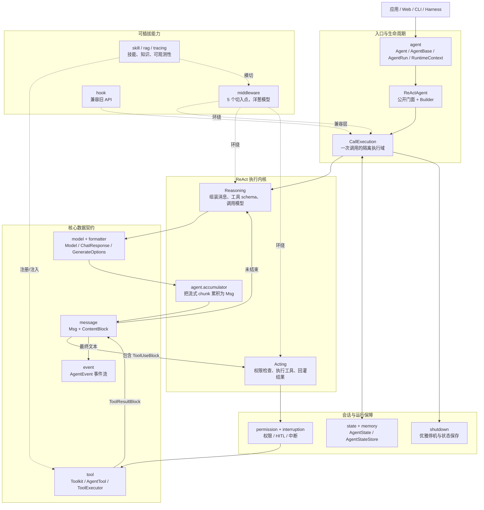
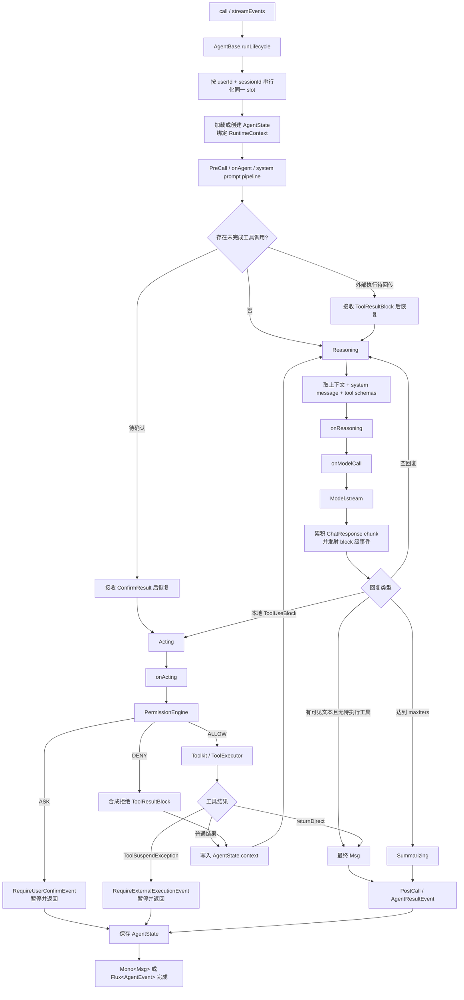
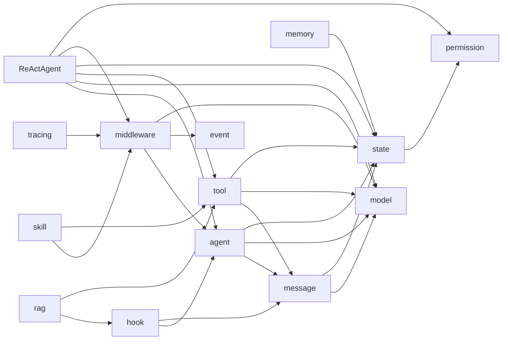
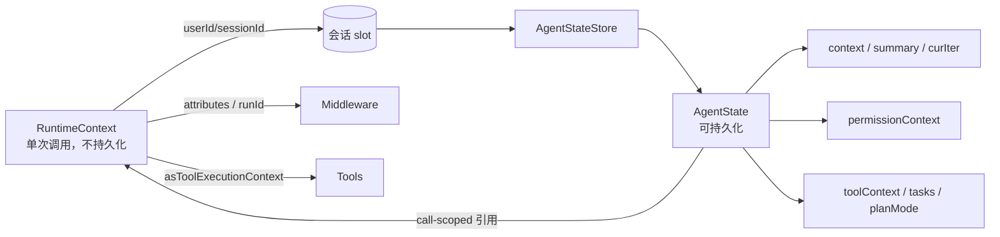

# agentscope-core 架构与源码阅读指南

> 基于 `2.0.4-SNAPSHOT`、提交 `857e3e6c` 整理。当前模块包含 309 个主源码文件、207 个测试文件、37 个 Java package namespace。本文的目标不是枚举每个类，而是先建立一张能指导源码阅读的“心智地图”。

配套的可交互画布见 [`agentscope-core-architecture.canvas`](./agentscope-core-architecture.canvas)。如果使用 Obsidian 或其他支持 JSON Canvas 的工具打开仓库，可以拖拽、缩放并直接沿节点跳到源码。

## 一句话理解

`agentscope-core` 是一个基于 Project Reactor 的 Agent 运行内核：`ReActAgent` 按 `(userId, sessionId)` 装载 `AgentState`，让模型产生文本或工具调用；工具调用经过权限判定和 `Toolkit` 执行后，以 `ToolResultBlock` 写回上下文，再进入下一轮推理，直到得到最终回复、需要人工介入、被中断或达到最大轮数。

## 1. 总体分层



### 最重要的边界

- `message` 是内部统一数据语言。用户消息、模型回复、思考、工具调用和工具结果最终都表示为 `Msg + ContentBlock`。
- `event` 是执行过程的实时投影。`call()` 最终只返回一个 `Msg`；`streamEvents()` 则把同一次执行投影成细粒度 `AgentEvent` 流。
- `model` 只负责“消息 + tool schema → `Flux<ChatResponse>`”，不负责 ReAct 循环。
- `tool` 只负责工具注册、schema 暴露和调用执行；是否要调用、何时继续循环由 `ReActAgent` 决定。
- `RuntimeContext` 是单次调用的非持久化元数据；`AgentState` 是按用户/会话隔离、可持久化的会话状态。两者不要混淆。
- `Middleware` 是 2.0 的主扩展面；`hook` 仍在主循环中，但主要承担旧 API 兼容。

## 2. 一次调用到底怎样跑



代码锚点：

- 生命周期骨架：`agent/AgentBase.java` 的 `runLifecycle(...)`、`runInContext(...)`。
- 单次调用执行域：`ReActAgent.java` 的内部类 `CallExecution`。
- 新调用与恢复分流：`CallExecution.doCallInner(...)`。
- 主循环：`coreAgent()` → `executeIteration()` → `reasoning()` / `acting()`。
- 终止条件：`isFinished(...)`。
- 同 slot 串行、不同 slot 并发：`AgentBase.callSerializationKey(...)` 与 `ReActAgent.activateSlotForContext(...)`。

## 3. 包之间的关系

下面按“阅读时应形成的职责块”分组，而不是机械地按目录排序。

| 层 | package | 主要职责 | 先看哪些类 |
|---|---|---|---|
| 门面 | `io.agentscope.core` | ReAct 编排入口、版本 | `ReActAgent` |
| Agent 契约 | `agent` | 调用、流式、观察、生命周期、单次运行控制 | `Agent`, `AgentBase`, `AgentRun`, `RuntimeContext` |
| 流式聚合 | `agent.accumulator` | 把模型的增量 chunk 合成最终内容块和消息 | `ReasoningContext`, `ToolCallsAccumulator` |
| 数据模型 | `message` | 消息、角色、文本/思考/多媒体/工具内容块 | `Msg`, `ContentBlock`, `ToolUseBlock`, `ToolResultBlock` |
| 事件协议 | `event` | Agent、模型、内容块、工具、HITL 的实时事件 | `AgentEvent`, `AgentEventType`, `AgentResultEvent` |
| 模型抽象 | `model` | 模型 SPI、调用参数、响应、工具 schema、模型注册 | `Model`, `ChatResponse`, `GenerateOptions`, `ToolSchema`, `ModelRegistry` |
| 格式转换 | `formatter` | Provider 消息格式、结构化输出 schema、媒体辅助 | `Formatter`, `ResponseFormat`, `JsonSchema` |
| 网络传输 | `model.transport*` | HTTP / WebSocket 抽象及 JDK、OkHttp 实现 | 后读；除非你在写模型 Provider |
| 工具体系 | `tool` | 注册、反射生成 schema、分组、并发执行、上下文注入 | `Toolkit`, `AgentTool`, `ToolBase`, `ToolExecutor` |
| 工具适配 | `tool.mcp`, `tool.subagent`, `tool.file`, `tool.coding` | MCP、子 Agent、文件与 shell 工具 | 按需求选读 |
| 扩展链 | `middleware` | Agent / reasoning / acting / model call 洋葱链及 system prompt 流水线 | `MiddlewareBase`, `MiddlewareChain` |
| 旧扩展链 | `hook` | 旧 Hook 事件与兼容调度 | `LegacyHookDispatcher`; 初学先略读 |
| 会话状态 | `state` | `AgentState` 聚合、Store SPI、文件/内存实现、CAS 冲突策略 | `AgentState`, `AgentStateStore`, `JsonFileAgentStateStore` |
| 记忆 | `memory` | AgentState 上的短期视图与长期记忆接入 | `AgentStateMemoryView`, `LongTermMemory` |
| 权限与暂停 | `permission`, `interruption` | ALLOW/ASK/DENY、模式/规则、协作式中断 | `PermissionEngine`, `PermissionContextState`, `InterruptControl` |
| 能力插件 | `skill`, `rag` | 动态 Skill、知识检索及其工具/中间件接入 | `SkillBox`, `DynamicSkillMiddleware`, `Knowledge` |
| 可靠性/观测 | `shutdown`, `tracing` | 优雅停机、状态落盘、OpenTelemetry | `GracefulShutdownMiddleware`, `OtelTracingMiddleware` |
| 公共支撑 | `util`, `credential` | JSON、消息辅助、schema、Provider 凭据 | 用到再读 |

### 核心依赖方向



这张图表示源码依赖的主方向，不是严格的无环分层。`message ↔ tool`、旧 `hook` 与新 `middleware` 等处存在少量反向引用，因此不要把它理解成严格 Clean Architecture。

## 4. 三种数据流要分开看

### 4.1 对话数据流

`UserMessage → AgentState.context → Model.stream → AssistantMessage → ToolUseBlock → ToolResultBlock → AgentState.context`

这是 ReAct 循环的“事实记录”。需要恢复会话时，真正要保存的是这条链所在的 `AgentState`。

### 4.2 实时事件流

```text
AgentStart
  ModelCallStart
    Thinking/Text/ToolCall Start → Delta* → End
  ModelCallEnd
  ToolResult Start → Delta* → End     （如有工具）
  ...下一轮...
  AgentResult
AgentEnd
```

事件用于 UI、SSE、日志与观测，不替代 `AgentState`。事件里的 `replyId`/`toolCallId` 用于把 start、delta、end 对齐。

### 4.3 上下文与状态流



## 5. 推荐阅读顺序

### 第 0 阶段：先跑通，不钻源码

1. `docs/v2/zh/docs/quickstart.md`
2. `agentscope-core/src/test/java/io/agentscope/core/SimpleIntegrationTest.java`
3. `docs/v2/zh/docs/building-blocks/agent.md`

目标：知道怎样创建 Model、Toolkit、ReActAgent，怎样调用 `call()` 和 `streamEvents()`。

### 第 1 阶段：先学“语言”——消息与模型契约

按顺序读：

1. `message/MsgRole.java`
2. `message/ContentBlock.java`
3. `message/Msg.java`
4. `message/UserMessage.java`、`AssistantMessage.java`
5. `message/ToolUseBlock.java`、`ToolResultBlock.java`
6. `model/Model.java`
7. `model/ChatResponse.java`
8. `model/GenerateOptions.java`、`ToolSchema.java`

目标：能回答“模型输入输出是什么”“工具调用如何嵌入消息”。先不读任何 Provider 的 HTTP 细节。

### 第 2 阶段：Agent 公共契约与生命周期

1. `agent/CallableAgent.java`、`StreamableAgent.java`、`ObservableAgent.java`
2. `agent/Agent.java`
3. `agent/AgentBase.java`：重点只读 `call(...)`、`runLifecycle(...)`、`runInContext(...)`、`notifyPreCall/PostCall(...)`
4. `agent/RuntimeContext.java`
5. `agent/AgentRun.java`

目标：分清调用、事件流、观察模式、中断、同会话串行化分别在哪一层处理。

### 第 3 阶段：工具链

1. `tool/AgentTool.java` 与 `ToolBase.java`
2. `tool/Tool.java`、`ToolParam.java` 注解
3. `tool/Toolkit.java`：注册、取 schema、`callTool(s)`
4. `tool/ToolExecutor.java`：验证、超时、重试、并发安全、执行
5. `tool/ToolExecutionContext.java` 与 `ToolCallParam.java`
6. 看测试：`ToolkitTest.java`、`ToolExecutorTest.java`、`ReflectiveFunctionToolTest.java`

目标：能够从一个 `ToolUseBlock` 一直追到 Java 方法调用，再回到 `ToolResultBlock`。

### 第 4 阶段：ReActAgent 主循环——不要从第 1 行顺读

建议按以下锚点跳读 `ReActAgent.java`：

1. 类注释和核心字段：理解它持有哪些不可变配置与 per-slot cache。
2. `Builder.build()`：理解 Agent 是怎样装配模型、Toolkit、Memory、RAG、Skill、Middleware 的。
3. `call(...)` / `streamEvents(...)` / `prepareRun(...)`：看公开入口如何汇合。
4. `callInternal(...)` / `buildAgentStream(...)`：看 `call` 与事件流怎样共用执行核心。
5. `activateSlotForContext(...)`：看一次调用怎样绑定 `(userId, sessionId)`。
6. 内部类 `CallExecution`：这是源码真正的中心。
7. `doCallInner(...)`：新调用、HITL 恢复、外部工具恢复怎样分流。
8. `coreAgent()`、`executeIteration()`、`reasoning()`、`acting()`。
9. `reasoningStream()` / `modelCallStream()`：模型 chunk 怎样变成事件和最终 Msg。
10. `actingStream()` / `evaluatePermissions()` / `dispatchToolCalls()`。
11. `isFinished()`、`summarizing()`：循环如何退出。

目标：自己能画出“reasoning → acting → reasoning”的状态机，并知道所有暂停点。

### 第 5 阶段：事件与流式累积

1. `event/AgentEvent.java`、`AgentEventType.java`
2. 各组 Start/Delta/End 事件，只需按文本、工具各挑一组精读
3. `agent/accumulator/ReasoningContext.java`
4. `TextAccumulator`、`ThinkingAccumulator`、`ToolCallsAccumulator`
5. 测试：`AgentEventStreamTest.java`、`ReActAgentCoarseStreamTest.java`

目标：理解流式 UI 怎样重建回复，以及最终 `Msg` 为什么不会丢 chunk。

### 第 6 阶段：扩展机制

1. `middleware/MiddlewareBase.java`：5 个切入点
2. `middleware/MiddlewareChain.java`：洋葱链构造
3. `FinalAnswerFilterMiddleware.java`、`TaskReminderMiddleware.java`
4. `hook/LegacyHookDispatcher.java`：只需理解它与主循环的兼容关系

目标：知道一个需求应该放在 `onAgent`、`onReasoning`、`onActing`、`onModelCall` 还是 `onSystemPrompt`。

### 第 7 阶段：状态、并发与恢复

1. `state/AgentState.java`
2. `state/AgentStateStore.java`
3. `InMemoryAgentStateStore.java` → `JsonFileAgentStateStore.java`
4. `ConflictPolicy.java`、`VersionedState.java`
5. 回到 `ReActAgent` 阅读 `loadOrCreateAgentStateForSlot(...)`、`saveStateToSession(...)` 和 CAS 冲突处理
6. 测试：`ReActAgentPerSessionStateTest.java`、`AgentStateStoreVersioningContractTest.java`

目标：解释为什么同一 Agent 实例可以服务多个用户，以及同 slot 为什么要串行。

### 第 8 阶段：生产级分支

按你的需求选读：

- 权限/HITL：`permission/*` + `ReActAgentHitlTest.java`
- 中断/停机：`interruption/*`、`shutdown/*`
- Skill：`skill/*` + `SkillRuntimeIntegrationTest.java`
- RAG/长期记忆：`rag/*`、`memory/*`
- MCP：`tool/mcp/*`
- 子 Agent：`tool/subagent/*`
- 结构化输出：`ResponseFormat`、`ReActAgentStructuredOutput*Test.java`
- 可观测性：`tracing/*`
- 自定义模型 Provider：`credential/*`、`model.spi/*`、`model.transport/*`

## 6. 初学时暂时跳过什么

- `ReActAgent` 里的结构化输出兼容细节、故障转移、returnDirect、优雅停机，第一次只认得分支即可。
- `model.transport` 和 WebSocket 实现，除非目标是开发新的模型 Provider。
- `hook` 下所有事件类；先掌握 Middleware，再回来理解兼容层。
- `skill`、`rag`、`shutdown` 的装配细节；它们依赖你已经理解主循环和 Toolkit。
- 207 个测试不要全读。以“一个概念 + 一个核心类 + 一个代表测试”为单位前进。

## 7. 用测试驱动阅读的最短路径

| 想理解的问题 | 代表测试 |
|---|---|
| 最小端到端调用 | `SimpleIntegrationTest` |
| 基本 ReAct 循环 | `ReActAgentTest`、`ReActAgentNewLoopE2ETest` |
| 工具执行 | `ToolkitTest`、`ToolExecutorTest` |
| 流式事件 | `AgentEventStreamTest`、`AgentStreamingTest` |
| Middleware 包裹顺序 | `ReActAgentMiddlewareIntegrationTest` |
| 多会话隔离 | `ReActAgentPerSessionStateTest` |
| 用户确认 | `ReActAgentHitlTest` |
| 中断工具调用 | `ReActAgentInterruptToolCallTest` |
| 结构化输出 | `ReActAgentStructuredOutputTest`、`ReActAgentStructuredOutputWithToolsTest` |
| Skill 运行时 | `SkillRuntimeIntegrationTest` |

## 8. 建议做的 4 个小实验

1. **无工具 Agent**：Mock Model 只返回 `TextBlock`，观察一次 reasoning 后直接结束。
2. **单工具 Agent**：第一轮返回 `ToolUseBlock`，工具返回 `ToolResultBlock`，第二轮返回文本；打印 `AgentState.context`。
3. **事件重建**：订阅 `streamEvents()`，只用 Start/Delta/End 事件在本地拼回文本和工具参数。
4. **会话隔离**：复用一个 Agent，交错调用两个 `RuntimeContext`，验证不同 `(userId, sessionId)` 的状态互不污染。

完成这四个实验后，再学习权限、Skill、RAG 或 MCP，认知负担会小很多。

## 9. 阅读时始终追问的五个问题

1. 这份数据属于单次调用 (`RuntimeContext`) 还是跨调用会话 (`AgentState`)？
2. 这是最终事实 (`Msg`) 还是实时投影 (`AgentEvent`)？
3. 这段逻辑位于 Agent 生命周期、reasoning、acting 还是原始 model call？
4. 发生错误/暂停后，哪些内容已经写入 `AgentState.context`，下一次调用从哪里恢复？
5. 当前对象是 Agent 级共享的，还是 `CallExecution` 级隔离的；并发调用是否安全？

抓住这五个问题，`agentscope-core` 看似庞大的 309 个类会收敛成一条很稳定的主线。
